# Thiết kế database Halora

PostgreSQL 18, một kho, tồn theo biến thể/SKU. Cấu trúc chính thức nằm trong `database/migrations`; `database/schema.sql` là bản xuất để cài trên database trống. Không chứa dữ liệu kinh doanh hoặc mật khẩu mặc định.

## Quan hệ chính

```mermaid
erDiagram
  accounts ||--o| customers : "hồ sơ CUSTOMER"
  accounts ||--o| employees : "hồ sơ STAFF"
  accounts ||--o{ auth_sessions : "phiên"
  accounts ||--o{ password_reset_tokens : "reset"
  employees ||--o{ employee_roles : "gán"
  roles ||--o{ employee_roles : "vai trò"
  roles ||--o{ role_permissions : "cấp quyền"
  permissions ||--o{ role_permissions : "quyền"
  customers ||--o{ customer_addresses : "địa chỉ"
  customers ||--|| carts : "giỏ"
  carts ||--o{ cart_items : "dòng"
  categories ||--o{ products : "loại sản phẩm"
  brands ||--o{ products : "thương hiệu"
  products ||--o{ product_variants : "SKU"
  products ||--o{ product_images : "ảnh"
  media_assets ||--o{ product_images : "file"
  product_variants ||--|| inventory_balances : "số dư"
  product_variants ||--o{ cart_items : "chọn mua"
  suppliers ||--o{ supplier_variants : "cung ứng"
  product_variants ||--o{ supplier_variants : "mặt hàng"
  suppliers ||--o{ goods_receipts : "nhập"
  goods_receipts ||--|{ goods_receipt_items : "dòng"
  product_variants ||--o{ goods_receipt_items : "nhập SKU"
  inventory_adjustments ||--|{ inventory_adjustment_items : "điều chỉnh"
  product_variants ||--o{ inventory_adjustment_items : "kiểm kê"
  product_variants ||--o{ stock_movements : "bút toán"
  customers ||--o{ orders : "mua"
  orders ||--|{ order_items : "snapshot hàng"
  product_variants ||--o{ order_items : "tham chiếu SKU"
  orders ||--o{ order_discounts : "snapshot ưu đãi"
  orders ||--o{ order_status_history : "lịch sử"
  promotions ||--o{ product_promotion_rules : "ưu đãi dòng"
  promotions ||--o{ order_promotion_rules : "ưu đãi đơn"
  promotions ||--o{ vouchers : "mã giảm"
  vouchers ||--o{ voucher_redemptions : "giữ và dùng"
  orders ||--o{ voucher_redemptions : "lịch sử giữ lượt voucher"
  orders ||--o{ payments : "thu tiền"
  payments ||--o{ refunds : "hoàn tiền"
  orders ||--o| invoices : "hóa đơn"
  invoices ||--|{ invoice_items : "giá gốc snapshot"
  accounts ||--o{ audit_logs : "thao tác"
  accounts ||--o{ idempotency_keys : "kết quả đã commit"
```

Đây là ERD nghiệp vụ; quan hệ bắt buộc và tên cột cụ thể xem [từ điển dữ liệu](data-dictionary.md) được xuất từ schema thực tế.

## Quy ước và ràng buộc

- ID UUID, ngày giờ `timestamptz`; cột SQL `snake_case`, DTO JSON `camelCase`.
- Domain `money_vnd` là `numeric(18,0)` không âm; tiền truyền qua API bằng chuỗi. Domain `discount_percent` là `numeric(5,2)` trong 0–100. Giá trị tính bằng số nguyên BigInt, làm tròn xuống tại từng bước giảm.
- `halora_code` dùng sequence để cấp mã hồ sơ/chứng từ, không dùng số lượng bản ghi để tạo mã. Sequence có thể có khoảng trống sau rollback.
- Các bản ghi chỉnh sửa có `created_at`, `updated_at`, `version`; trigger `halora_touch` tăng version. Ghi sửa phải khóa/kiểm tra version trong transaction.
- Username/email unique trong từng realm, không phân biệt hoa thường. Khóa ngoại ghép account/realm bảo đảm hồ sơ nhân viên/khách đúng nhóm tài khoản.
- Tên loại sản phẩm, thương hiệu và SKU unique sau trim/lower; product slug unique.
- Một giỏ/khách, một dòng/SKU trong giỏ/đơn, tối đa một hóa đơn/đơn. Partial unique index bảo đảm tối đa một địa chỉ mặc định/khách.
- Khóa ngoại ghép `(product_id, variant_id)` bảo đảm ảnh/dòng hàng thuộc đúng sản phẩm. Phiếu nhập còn tham chiếu `(supplier_id, variant_id)` để bảo đảm đúng cung ứng.
- Dòng giao dịch, bút toán kho và hồ sơ đã được sử dụng dùng FK hạn chế xóa. Chỉ dữ liệu phụ thuộc tạm thời như dòng giỏ, token phiên mới được xóa theo chủ thể.
- `inventory_balances.stock_quantity >= 0`; `stock_movements` lưu `quantity_delta`, trước/sau và nguồn. Unique theo biến thể/loại nguồn/ID nguồn chống xuất/nhập cùng nguồn lặp.
- Ràng buộc check kiểm tra giá trị của bản ghi; tổng chứng từ, trạng thái hợp lệ và điều kiện liên bảng do service kiểm tra cùng transaction. Không dùng CHECK liên bảng.

## Nhóm dữ liệu

| Nhóm | Trách nhiệm |
|---|---|
| accounts, employees, customers | Tài khoản, hai realm và hồ sơ; khóa tài khoản thu hồi phiên |
| roles, permissions, employee_roles, role_permissions | Quyền chi tiết; vai trò mặc định ADMIN, SALES, WAREHOUSE, ACCOUNTANT, CUSTOMER |
| auth_sessions, password_reset_tokens | Chỉ lưu hash refresh/reset token; xoay vòng, thu hồi và token reset dùng một lần |
| customer_addresses, carts, cart_items | Địa chỉ hiện tại, giỏ riêng khách; chưa giữ kho |
| categories, brands, products, product_variants | Loại sản phẩm, thương hiệu, mô tả và SKU/giá hiện hành |
| media_assets, product_images | File thật và thứ tự ảnh; ảnh public không chứa credential |
| suppliers, supplier_variants | Nhà cung cấp và danh sách SKU được cung ứng |
| promotions, product_promotion_rules, order_promotion_rules, vouchers | Mỗi chương trình có một type PRODUCT/ORDER/VOUCHER; khóa ngoại ghép chặn điều kiện sai loại; đơn vẫn kết hợp chương trình khác nhau |
| promotion_usage | Sổ từng áp dụng điều kiện; trigger từ order_discounts, không mất dấu khi sửa đơn chờ; FK ngăn xóa cấu hình đã dùng |
| orders, order_items, order_discounts, order_status_history | Snapshot giao dịch và lịch sử trạng thái; sửa hồ sơ không đổi giao dịch cũ |
| voucher_redemptions | HELD khi đặt, USED khi xác nhận, RELEASED khi hủy hợp lệ; giữ lượt có khóa đồng thời |
| payments, refunds | Đối soát thu/hoàn thủ công, số tiền đã xác nhận, mã tham chiếu unique |
| invoices, invoice_items | Hóa đơn từ đơn hoàn tất, tổng dòng theo giá gốc; không tác động kho |
| goods_receipts, goods_receipt_items | Phiếu nhập DRAFT → POSTED; POSTED mới tăng kho |
| inventory_adjustments, inventory_adjustment_items | Điều chỉnh có lý do, delta và người thực hiện; POSTED khóa nội dung |
| inventory_balances, stock_movements | Số dư và sổ kho; cập nhật trong cùng transaction, không ghi lùi thời điểm |
| audit_logs, idempotency_keys | Truy vết thao tác; lưu kết quả giao dịch để retry cùng khóa không làm lại |

Các view `api_*` tổng hợp cấu trúc trả cho API, loại bỏ hash/token và giữ tiền dạng chuỗi. Báo cáo dựa trên bảng gốc để kiểm soát thời điểm ghi nhận và tránh nhân đôi tổng khi join dòng hàng.

## Migration và vận hành

Cài mới bằng migration hoặc bản xuất schema, chọn một cách. Schema có baseline `pgmigrations` để những migration cũ không chạy lại. Chỉ tạo roles/permissions hệ thống; tài khoản quản trị được tạo bằng lệnh bootstrap riêng.

Database đang dùng phải nâng cấp bằng migration mới, không sửa file đã áp dụng và không nhập lại toàn schema. `db:verify-schema` tạo hai database thử riêng, đối chiếu bảng/view/sequence/ràng buộc và kiểm tra không áp dụng lại migration sau import. Chi tiết chạy, backup và restore có trong README.

Migration 008 tách cấu hình nhiều loại cũ thành chương trình riêng mà không sửa orders, order_items, order_discounts, voucher_redemptions hay promotion_usage. Điều kiện/voucher giữ UUID và lượt dùng; các tham chiếu trên đơn cũ vẫn trỏ về chương trình lịch sử. View `api_promotions` tính `has_usage` theo cả ledger gốc và cha hiện tại của điều kiện, đồng thời trả `type` và `has_conditions`. Bản xuất schema hiện gồm đủ 8 migration.
